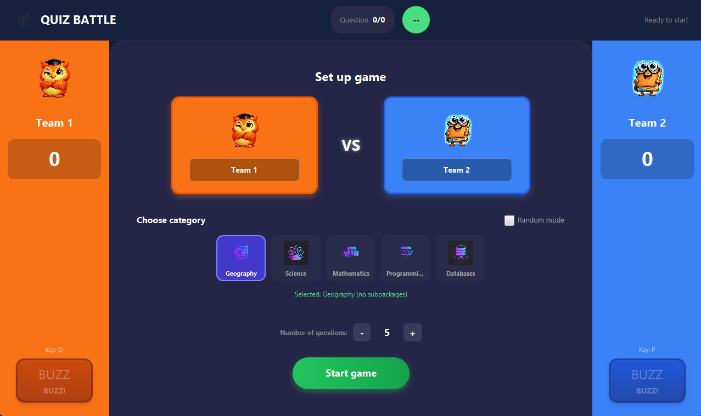
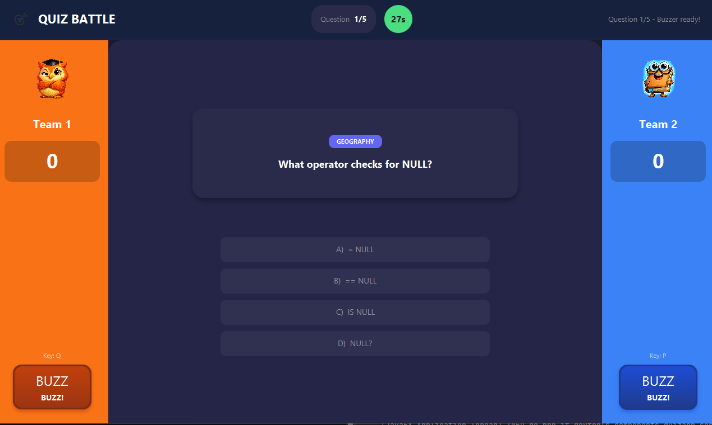

# QuizBattle 🎯

**QuizBattle** is a desktop quiz game for two teams, built with **Java 21**, **JavaFX**, and **Gradle**. Teams compete across multiple questions, use buzzers to answer first, and earn points for correct answers.

> Developed collaboratively as part of a software engineering university project at Hochschule Heilbronn.

## Features

- **Two-team competition:** Enter team names, track scores, and display the winner at the end.
- **Buzzer system:** Players can buzz in using on-screen buttons or keyboard shortcuts.
- **Question categories:** Geography, science, mathematics, programming, and databases.
- **Topics:** Examples include capitals, physics, algebra, Java, Python, and SQL.
- **Question types:** Multiple-choice questions and free-text answers.
- **Game configuration:** Choose between 1 and 20 questions and enable random mode.
- **Timers:** Countdown timers for buzzing in and answering.
- **Play again:** Start a new game after a match finishes.

Questions are currently provided as **sample data in the source code** and loaded when the game starts. No external database or internet connection is required to play.

## Technologies

| Area | Technology |
| --- | --- |
| Programming language | Java 21 |
| User interface | JavaFX 21, FXML, CSS |
| Build tool | Gradle (Wrapper included) |
| Architecture | Separate API, game-logic, and UI modules; Java Platform Module System (JPMS) |
| Testing | JUnit 5 |
| Logging | SLF4J |

## Requirements

- **JDK 21**
- **IntelliJ IDEA** (recommended) or another Java IDE
- Internet access for the **first Gradle synchronization** to download dependencies

JavaFX does not need to be installed separately; the Gradle configuration manages the required dependencies.

## Run in IntelliJ IDEA

1. Clone or download the repository and open the **`QuizBattle`** folder using **File → Open**.
2. Select **JDK 21** under **File → Project Structure → Project**.
3. Select JDK 21 for **Gradle JVM** under **Settings → Build, Execution, Deployment → Build Tools → Gradle**.
4. Reload the Gradle project using **Reload All Gradle Projects**.
5. Open the integrated terminal and run the appropriate command.

**Windows (PowerShell):**

```powershell
.\gradlew.bat :javafx:run
```

**Linux / macOS:**

```bash
./gradlew :javafx:run
```

Alternatively, run `javafx/src/main/java/de/hhn/it/devtools/javafx/Main.java` from IntelliJ once the project and JavaFX dependencies have been configured.

The application starts **QuizBattle directly**, without a menu for other sample applications.

## How to Play

1. Enter names for **Team 1** and **Team 2**.
2. Select a category and, if applicable, a topic, or enable **random mode**.
3. Choose the number of questions and click **Start game**.
4. Buzz in using the keyboard:
   - **Q:** Team 1
   - **P:** Team 2
5. For multiple-choice questions, use a button or press **1–4** or **A–D**. For free-text questions, type and submit an answer.
6. Review the final score and choose **NEW GAME** to play again.

## Project Structure

```text
QuizBattle/
├── apis/            # Data models, enums, service interfaces, and exceptions
├── components/      # Quiz game logic, states, answer validation, and questions
│   └── src/test/    # JUnit tests for the game logic
├── javafx/          # JavaFX UI (FXML, controllers, ViewModel, CSS, images)
├── gradle/wrapper/  # Gradle Wrapper
├── gradlew          # Linux/macOS wrapper script
├── gradlew.bat      # Windows wrapper script
└── README.md
```

Questions and categories are defined in:

`components/src/main/java/de/hhn/it/devtools/components/quizapp/service/generator/QuizDataGenerator.java`

## Run Tests

**Windows (PowerShell):**

```powershell
.\gradlew.bat test
```

**Linux / macOS:**

```bash
./gradlew test
```

## SCreenshots 

- Home screen




- Gameplay screen




## Project Notes

- QuizBattle is a **local two-team game**, not an online multiplayer application.
- The project was developed as a **university team project**. Its features and code are the result of collaborative work.
